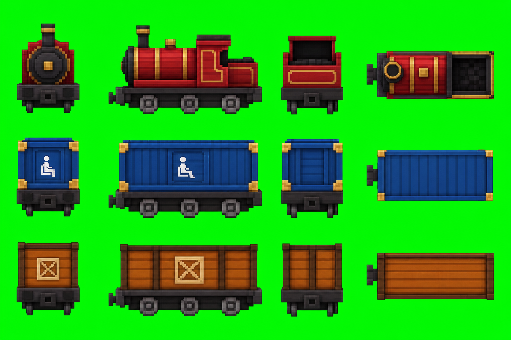

# 模拟火车

一个适用于 Minecraft（我的世界）Fabric（织物）平台的列车、线路、车站、车辆段与自动货运模组。

当前正式版本：`0.2.40`

[下载正式版](https://github.com/quit5700/train/releases/tag/v0.2.40) · [查看全部发行版](https://github.com/quit5700/train/releases) · [支持版本明细](SUPPORTED_VERSIONS.md)



> 图片为车辆模型设计参考；游戏中的车辆长度已适配原版矿车碰撞与连接距离。

## 主要功能

- 信号铁轨支持直线、转弯和连续上下坡，并使用原版铁轨连接逻辑。
- 四向道岔分别处理手动列车方向和线路自动列车路径。
- 车站支持到站广播、停车时间和货车向相邻容器卸货。
- 车辆段支持编组模板、线路绑定、立即生成、立即发车、定时发车、回收和列车列表。
- 火车头、客车和货车可通过列车连接器组成有序列车；客货车厢允许混编。
- 手动列车支持玩家乘坐及 `W` / `S` 驾驶；线路自动列车按保存的线路节点运行。
- 货车拥有 27 格库存，可单独指定卸货车站，也可继承火车头的卸货车站。
- 发电机通过红石粉连接信号铁轨；红石粉供电 1 小时，红石块供电 7 小时。
- 支持线路、设备、列车编号、货运状态和离线运行数据持久化。
- 玩家可见文字提供简体中文、繁体中文、英语、日语、韩语、德语、法语和西班牙语。

## 安装

1. 从 [GitHub Releases（GitHub 发行版）](https://github.com/quit5700/train/releases/tag/v0.2.40) 下载与 Minecraft 版本完全对应、文件名中不含 `sources` 的 JAR（Java 归档）。
2. 安装下表对应的 Fabric Loader（Fabric 模组加载器）和 Fabric API（Fabric 应用程序接口）。
3. 将模组 JAR 放入当前游戏实例的 `mods` 文件夹。
4. 客户端和服务器使用相同的 Minecraft 与模组版本。

`*-sources.jar` 是供开发者阅读源码使用的源码包，不要作为普通游戏模组安装。

## 支持版本

| Minecraft（我的世界） | Java（爪哇） | Fabric Loader（Fabric 模组加载器） | Fabric API（Fabric 应用程序接口） | Fabric Loom（Fabric 构建插件） | Mappings（命名映射） |
|---|---:|---|---|---|---|
| 26.2 | 25 | 0.19.3 | 0.154.0+26.2 | 1.15.5 | Mojang Official（Mojang 官方）26.2 |
| 26.1.2 | 25 | 0.19.3 | 0.153.0+26.1.2 | 1.15.5 | Mojang Official（Mojang 官方）26.1.2 |
| 1.21.11 | 21 | 0.19.3 | 0.141.5+1.21.11 | 1.15.5 | Mojang Official（Mojang 官方）1.21.11 |
| 1.21.8 | 21 | 0.17.3 | 0.136.1+1.21.8 | 1.11.8 | Mojang Official（Mojang 官方）1.21.8 |
| 1.21.4 | 21 | 0.16.14 | 0.119.4+1.21.4 | 1.9.2 | Mojang Official（Mojang 官方）1.21.4 |
| 1.21.1 | 21 | 0.16.14 | 0.116.12+1.21.1 | 1.7.4 | Mojang Official（Mojang 官方）1.21.1 |
| 1.20.4 | 17 | 0.15.11 | 0.97.3+1.20.4 | 1.6.12 | Mojang Official（Mojang 官方）1.20.4 |
| 1.20.1 | 17 | 0.15.11 | 0.92.9+1.20.1 | 1.6.12 | Mojang Official（Mojang 官方）1.20.1 |

本项目未使用 Yarn Mappings（Yarn 命名映射）。完整构建信息见每个 `mc<版本>/VERSION_INFO.md`。

## 基本操作

### 建设与设置

- 放置模组信号铁轨、车站、道岔、车辆段和发电机。
- `Ctrl（控制键）+右键`车站、道岔或车辆段：打开对应设置。
- 普通右键车辆段：打开 54 格车辆段库存。
- `Shift（潜行键）+右键`不会打开这些设备的设置，可用于在设备上方正常铺轨。
- 手持铁路线路设置器右击空气：打开铁路线路设置界面。

### 列车与货运

- 手持车辆物品右击模组铁轨：放置火车头、客车或货车。
- 使用列车连接器依次左键两辆车：连接或断开相邻车辆；最远选择距离为 16 格。
- 普通右键火车头或客车：乘坐。
- `Shift（潜行键）+右键`火车头：设置列车类别和默认卸货站。
- `Shift（潜行键）+右键`货车：选择该车厢的卸货站或执行全部卸货。
- 手动列车由拥有控制权的乘客使用 `W` / `S` 驾驶。

### 自动线路

1. 使用线路设置器新建线路。
2. 按列车运行顺序加入车站、道岔和需要的回收车辆段。
3. 为线路中的每个道岔选择该次经过时的方向。
4. 在车辆段设置中选择线路和编组，保存设置。
5. 使用“立即发车”启动线路自动列车；后续列车按发车间隔补充到在轨上限。

自动列车读取线路保存的节点和道岔方向，不读取道岔界面中供手动列车使用的可见方向。

## 0.2.40 更新

- 线路设置器选中线路时显示“正在修改：线路名称”。
- 服务端确认保存成功后显示“已保存”，并返回线路设置初始页面。
- Minecraft 1.21.8 和 1.21.11 修复首次立即发车可能误报线路断点的问题。
- 八个支持版本均通过 `clean build`（清洁构建），同时发布运行 JAR 与 sources JAR。

## 从源码构建

每个 Minecraft 版本位于独立目录中。以下为 Windows PowerShell（微软命令行）示例：

```powershell
Set-Location -LiteralPath ".\mc26.2"
.\gradlew.bat clean build --no-daemon --console=plain
```

构建结果位于对应版本的 `build/libs`，正式分发文件位于 `dist`（分发目录）。

## 数据与升级建议

- 更新模组或跨 Minecraft 版本迁移世界前，请先备份存档。
- 不要同时安装两个不同版本的本模组 JAR。
- 旧线路数据会按现有迁移逻辑恢复；迁移后建议打开线路设置器检查设备和线路，再测试发车。
- 遇到问题时请保留游戏日志、崩溃报告、Minecraft 版本和模组文件名。

